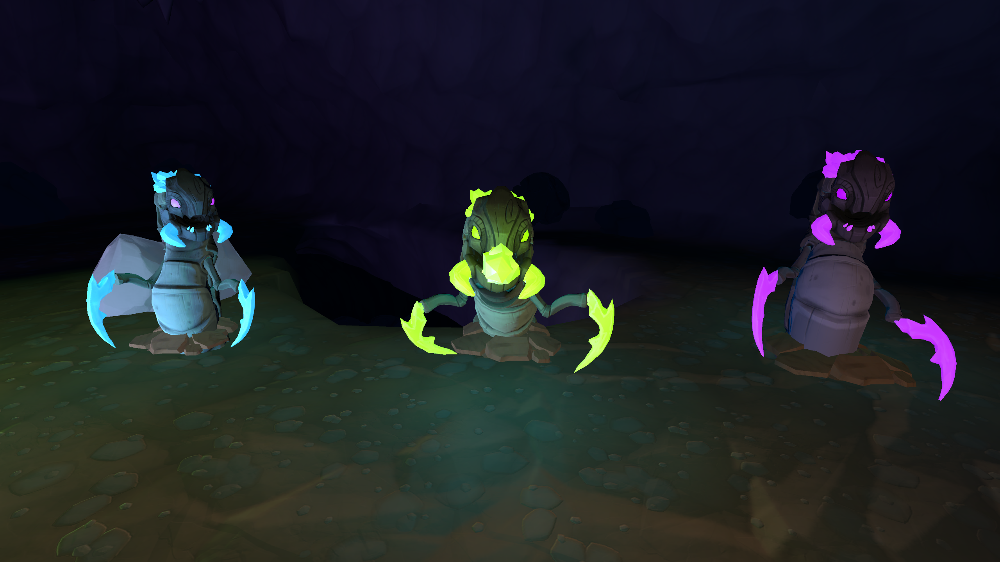
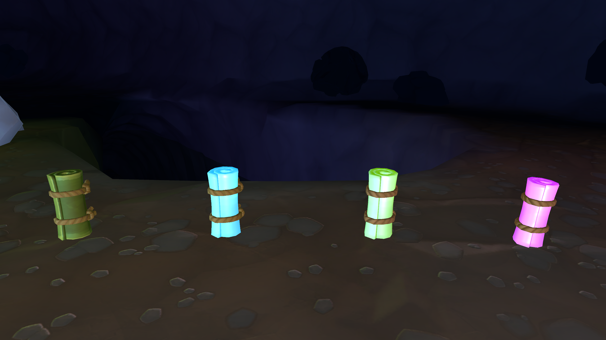
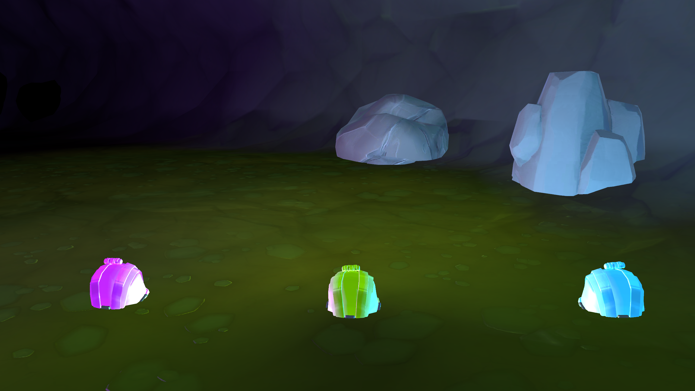
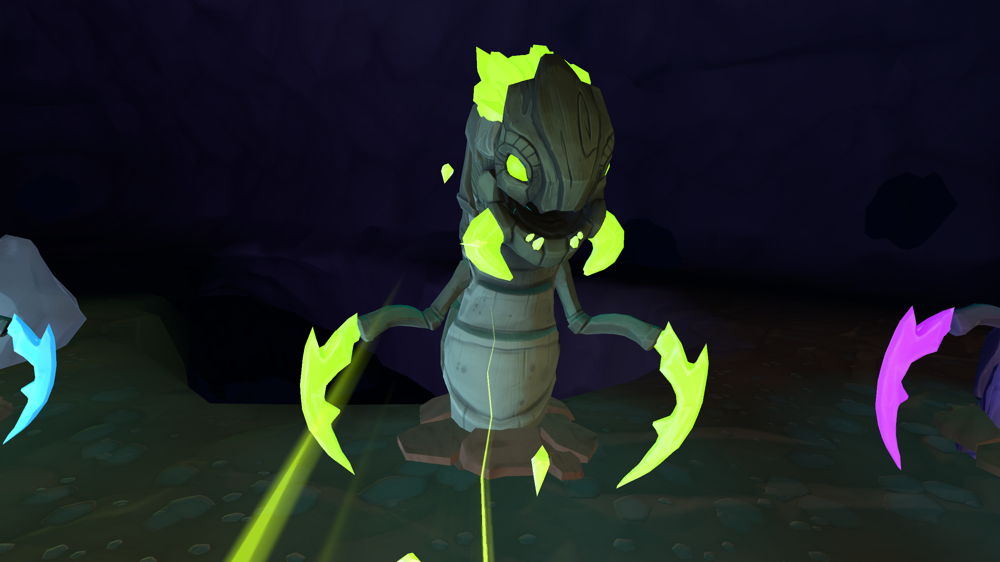
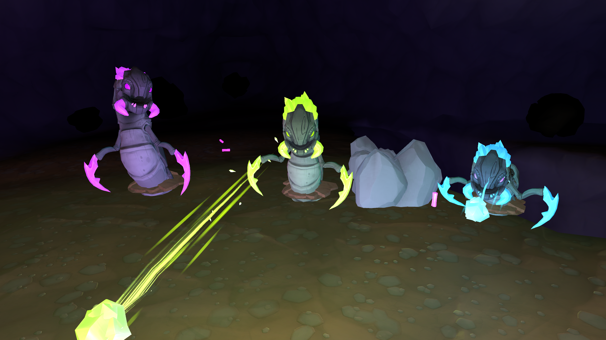
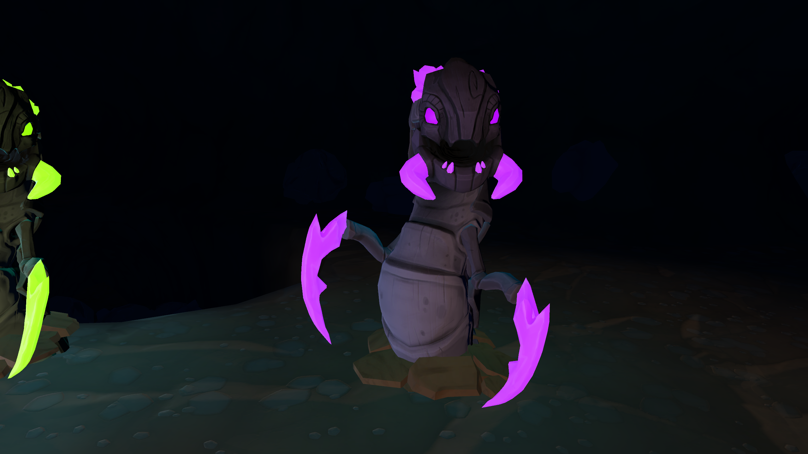
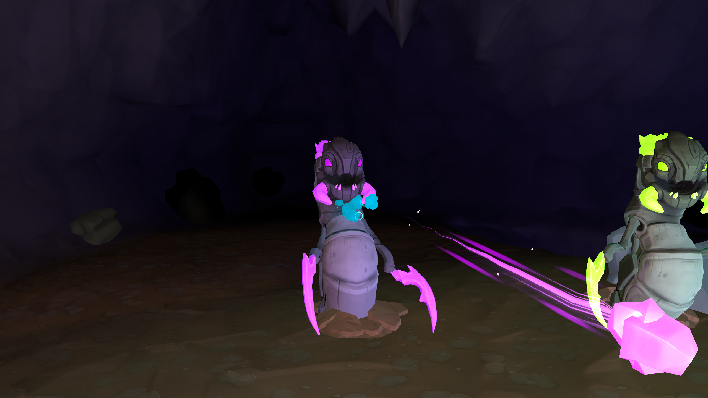

# CrystalLeather

A mod for A Township Tale that makes the deep mines worth going down for. Crystal wyrms drop glowing leather in their own color, two new crystal wyrms show up the deeper you dig, and every wyrm gets tougher the further down it is.

## Crystal leather

Crystal wyrms drop **Crystal Leather** instead of normal wyrm leather. It comes in the wyrm's color: blue, green or purple. It works exactly like normal wyrm leather and fits every recipe it does. The difference is that it glows.

Crystal wyrms drop leather as often as normal wyrms do: a 1 in 4 chance per kill, usually a medium roll and sometimes a large one. (The base game gives crystal wyrms a second roll. The mod takes that away so every wyrm drops the same.)

*Normal wyrm leather on the left, crystal leather in each color next to it.*

A single piece gives off a faint glow. The more crystal leather something is made of, the brighter it gets, and a full bag made of it lights up the cave around you. It keeps glowing when you're wearing it or carrying it, and an item made from more than one color glows in each of them.

## Green and purple wyrms

Blue crystal wyrms are the normal ones and still show up on every crystal level. Below level 50 you start running into **green** ones, and below level 100 **purple** ones. They're rare at first and get more common the deeper you go. At least 15% of crystal wyrms always stay blue.

| Level | Blue | Green | Purple |
|---|---|---|---|
| 1 to 49 | 100% | – | – |
| 50 | 95% | 5% | – |
| 75 | 75% | 25% | – |
| 100 | 50% | 45% | 5% |
| 125 | 35% | 40% | 25% |
| 150 and deeper | 15% | 40% | 45% |

Both are bigger and meaner than the blue ones, and their spit is their own color.

| | Size | Health | Damage | Attack speed |
|---|---|---|---|---|
| Blue | normal | normal | normal | normal |
| Green | +15% | +75% | +40% | +20% |
| Purple | +30% | +150% | +80% | +35% |

**Green** wyrms are the hunters. They react faster, come up out of the ground for you from further away (22.5 m instead of 15), spit from further away (28 m instead of 20), bite twice in a row more often, and stay above ground longer before they dig back in.

 

**Purple** wyrms are the tanks. They take 25% less damage from blunt weapons, and once they drop below half health they go into a rage: they get faster and spin and spit twice as often.

 

## Deeper means tougher

Every wyrm in the mines, normal ones included, gets a bit stronger with each level:

- +1.5% health per level
- +0.8% damage per level
- +0.3% attack speed per level

This stops growing at level 150. A wyrm's attack speed is never more than double the normal speed. To see the exact numbers for a level, type `wyrmvar odds <level>` in the server console.

## Install

You need the final game build (`main-1.7.2.1.42203`) with MelonLoader v0.7.3 installed. The Modding Tavern launcher sets that up for you.

**The server and every player need the mod.** Green and purple wyrms are new creatures and crystal leather is a new material, so players without the mod won't see them properly. That includes Quest players (see [Quest](#quest) below).

1. Close the game (or stop the server).
2. Drop `CrystalLeather.dll` (it's in this folder, ready to use) into the game's `Mods` folder.
3. Start it up. You should see `CrystalLeather 1.1.1 starting` in the MelonLoader log.

Don't take the mod off a server once green or purple wyrms or crystal leather are in the world. They need the mod to load.

### Quest

Players on the standalone Quest version can play on a server with CrystalLeather too. They need MelonLoader on their Quest and the Quest build of the mod, `CrystalLeather.Quest.dll`. The server itself always runs the normal `CrystalLeather.dll`, quest scene or not.

1. Install MelonLoader on your Quest. *(Steps coming soon.)*
2. Put `CrystalLeather.Quest.dll` (it's in this folder) into the Quest game's `Mods` folder.
3. Start the game. You should see `CrystalLeather 1.1.1 starting (quest)` in the MelonLoader log.

With it, you see the same green and purple wyrms and the same glowing leather as players on PC.

## Console commands

These are for server admins, typed into the server console:

- `wyrmvar list [level]` lists the wyrms that are loaded right now, with their color, health and boosts.
- `wyrmvar odds <level>` shows the color chances on a level and how tough each kind of wyrm is there.
- `wyrmvar spawn <blue|green|purple|normal> <player>` spawns a wyrm 6 m in front of a player. They have to be in the mines.
- `wyrmvar clear <player>` removes every wyrm within 30 m of a player.
- `wyrmvar verbose <true|false>` logs every wyrm attack and hit, for when something seems off.

## Known issues

- A wyrm that was hurt gets its health back when the server restarts.
- Purple wyrms only spawn on level 100 and deeper, so you won't see one until your mine goes that far down. You can still spawn one with `wyrmvar spawn purple <player>`.

## For other modders

The new creatures use the prefab hashes 52392 to 52395 (green wyrm, purple wyrm, green spit, purple spit). The leathers use the material hashes 1276475934 (Crystal Leather), 1276475950 (Green) and 1276475966 (Purple). If another mod already uses one of the creature hashes, that color turns itself off and says so in the log.

To build it yourself, run `.\build.ps1` (add `-GamePath` if your game isn't in `C:\Games\Alta\A Township Tale`).

To build the Quest version, run `.\build_quest.ps1`. It needs the .NET 8 SDK and the Quest reference DLLs from [ATT-Quest-Modding-dlls](https://github.com/TheRavenSeb/ATT-Quest-Modding-dlls). By default it looks for them in `..\ATT Quest Dlls\questdlls`. Pass `-QuestDlls` with the `questdlls` folder if yours is somewhere else. Both versions are built from the same source files. The Quest one only has what runs on a player's game, since servers always run the PC version.
